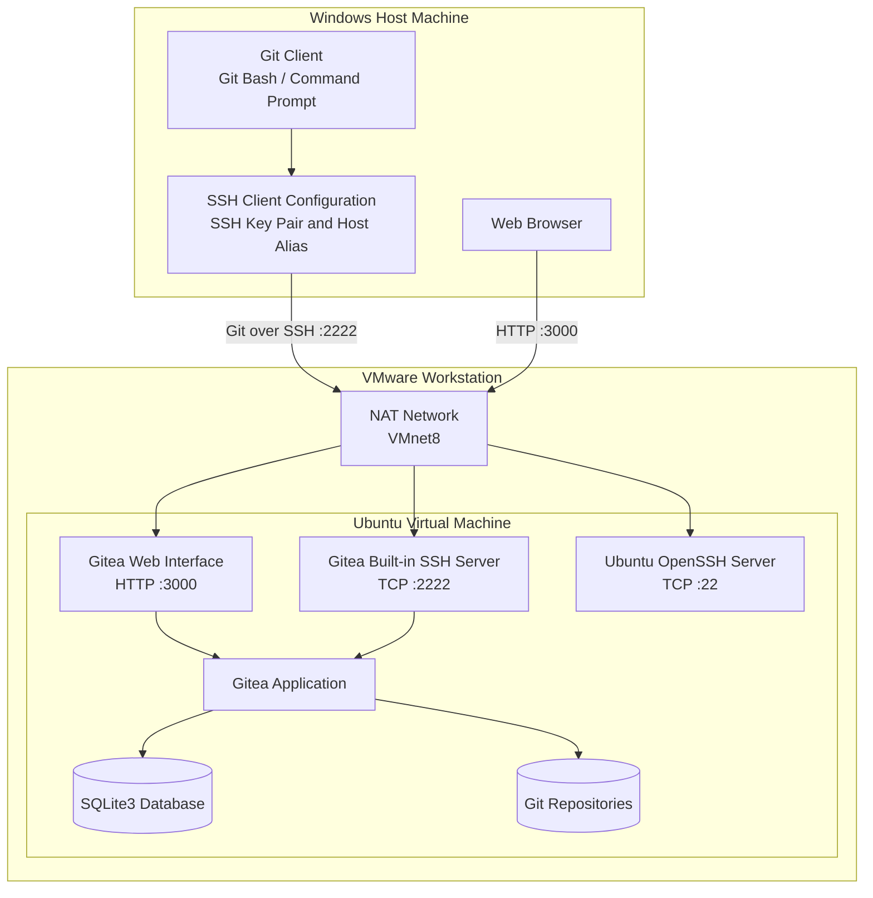

# System Architecture

## Overview

This project implements a self-hosted Git hosting platform using Gitea, deployed on an Ubuntu virtual machine running inside VMware Workstation.

The architecture separates the Git client and server responsibilities. The Windows host machine acts as the client, while the Ubuntu virtual machine runs the Gitea server and manages Git repositories.

VMware NAT networking (VMnet8) provides network connectivity between the Windows host and the Ubuntu virtual machine.

Gitea uses SQLite3 as its database to store application-related information, while Git repositories are maintained on the Ubuntu server.

## Architecture Diagram

The following diagram illustrates the overall architecture and communication between the components.



## Components and Responsibilities

### 1. Windows Host Machine

The Windows machine acts as the primary client used to interact with the self-hosted Git platform.

Responsibilities:

- Access the Gitea web interface through a browser.
- Create and manage local Git repositories.
- Clone repositories hosted on Gitea.
- Perform Git operations such as add, commit, push, and pull.
- Authenticate with Gitea using SSH keys.

Git Bash and Command Prompt are used to execute Git commands.

The Windows SSH client configuration file stores the Gitea host alias, server IP address, username, port, and private key location.

### 2. VMware Workstation

VMware Workstation provides the virtualization environment used to run Ubuntu independently of the Windows host operating system.

The Ubuntu virtual machine acts as the server hosting the Gitea application.

The virtual machine can be started and managed independently while continuing to use the host machine's hardware resources.

### 3. VMware NAT Networking (VMnet8)

The virtual machine uses VMware's NAT networking mode.

VMnet8 provides network connectivity between the Windows host and the Ubuntu virtual machine.

In this configuration:

- The Ubuntu VM receives an IP address from the VMware NAT network.
- The VM can access external networks through the host's network connection.
- The Windows host can communicate with services running inside the Ubuntu VM using its VMnet8 network address.

The Windows host and Ubuntu VM use their respective network addresses to communicate with the Gitea web interface and SSH services.

### 4. Ubuntu Virtual Machine

Ubuntu acts as the server operating system hosting the self-hosted Git platform.

It runs the following services:

- Gitea application.
- Gitea built-in SSH server.
- Ubuntu OpenSSH server.
- SQLite3 database used by Gitea.

Gitea is configured as a systemd service so that it can start automatically when Ubuntu boots.

### 5. Gitea

Gitea is the self-hosted Git hosting application deployed on Ubuntu.

It provides a web-based interface for managing Git repositories and users.

Responsibilities:

- Repository creation and management.
- Git operations over SSH.
- SSH public key management.
- Repository browsing through the web interface.
- Storing application information in SQLite3.

Gitea is accessible through two primary interfaces:

- Web interface using HTTP on port `3000`.
- Built-in SSH server using TCP port `2222`.

### 6. SQLite3 Database

SQLite3 is used as the database backend for Gitea.

It stores Gitea application data, including information related to users, repositories, and other application features.

The database is stored locally on the Ubuntu virtual machine.

Database location:

```text
/var/lib/gitea/data/gitea.db
```

The Git repository contents are maintained separately from the SQLite database.

### 7. SSH Services

Two separate SSH services are used in this architecture.

**Ubuntu OpenSSH Server**

- Runs on TCP port `22`.
- Used for remote administration of the Ubuntu virtual machine.
- Allows SSH access to Linux user accounts when configured.

**Gitea Built-in SSH Server**

- Runs on TCP port `2222`.
- Handles Git authentication and remote repository operations.
- Uses public keys registered through the Gitea web interface.
- Does not provide interactive shell access.

Keeping these services on separate ports allows Ubuntu administration and Gitea Git operations to work independently.

## Network Ports

The following table describes the network ports used in the project.

| Port | Protocol | Service | Purpose |
|---|---|---|---|
| 22 | TCP | Ubuntu OpenSSH | Remote Ubuntu administration |
| 3000 | TCP | Gitea Web Interface | Browser-based repository management |
| 2222 | TCP | Gitea Built-in SSH | Git clone, push, and pull operations |

All three services run inside the Ubuntu virtual machine.

## Communication Flow

### 1. Accessing the Gitea Web Interface

1. The user opens a web browser on the Windows host.
2. The browser connects to the Ubuntu VM using its IP address and port `3000`.
3. VMware NAT networking provides connectivity to the virtual machine.
4. Gitea processes the request and displays the web interface.

Example URL:

```text
http://<UBUNTU_IP>:3000
```

### 2. Git Operations Through SSH

1. The user executes a Git command from the Windows client.
2. The SSH client reads the configured Gitea host alias.
3. The SSH client connects to the Ubuntu VM on port `2222`.
4. Gitea authenticates the connection using the registered SSH public key.
5. Gitea processes the requested Git operation against the selected repository.

Example clone command:

```bash
git clone gitea:<GITEA_USERNAME>/<REPOSITORY_NAME>.git
```

### 3. Remote Ubuntu Administration

1. The user initiates an SSH connection from the Windows host.
2. The connection reaches Ubuntu's OpenSSH service on port `22`.
3. Ubuntu authenticates the Linux user.
4. The user can execute administrative commands on the virtual machine.

This connection is separate from Gitea's built-in SSH service.

## Repository and Data Storage

Gitea maintains its application data and Git repositories on the Ubuntu virtual machine.

Important locations include:

| Path | Purpose |
|---|---|
| `/usr/local/bin/gitea` | Gitea executable |
| `/etc/gitea/app.ini` | Gitea application configuration |
| `/var/lib/gitea/data/` | Gitea application data and SQLite database |
| `/var/lib/gitea/custom/` | Custom Gitea files |
| `/var/lib/gitea/log/` | Gitea log files |
| `/var/lib/gitea/` | Gitea working directory |

The systemd service configuration is stored at:

```text
/etc/systemd/system/gitea.service
```

## Architecture Summary

The project uses a simple client-server architecture:

- Windows acts as the Git client and provides browser-based access.
- VMware Workstation hosts the Ubuntu virtual machine.
- Ubuntu runs the Gitea application and its supporting services.
- VMware NAT networking provides communication between the host and virtual machine.
- Gitea provides HTTP and SSH interfaces for repository management.
- SQLite3 stores Gitea application information.
- Git repositories are maintained on the Ubuntu server.

This architecture provides a lightweight, self-hosted Git hosting environment without requiring a separate physical server or containerization platform.
